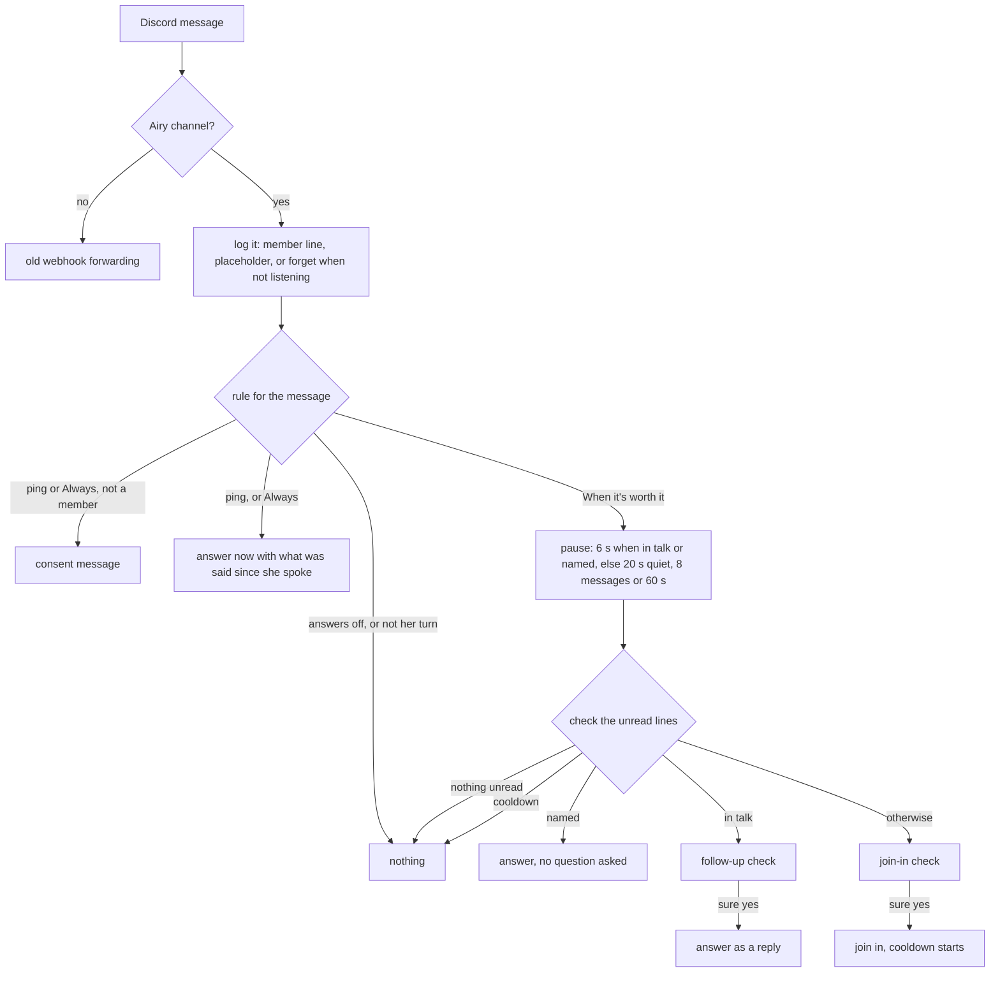

# How Airy talks in Discord channels

Airy answers in the channels picked on the panel's Channels page. Each channel has an answer rule (Always, When
mentioned, When it's worth it) and a Listens switch. This page is the design as it runs on prod; lessons are in
[lessons.md](lessons.md), the review of real traffic in [reviews/](reviews/), the rework that gave it this shape in
[plan.md](plan.md).

## Words

| Word | Meaning |
|---|---|
| ping | a Discord mention of Airy or a reply to one of her messages |
| named | her name or a nickname (Airy, fox, foxy, kitsune) in a message, without a ping; `#airy-talk` and links do not count |
| member | someone who opted in (the consent button); only members are heard and answered |
| channel log | the last 30 lines of a channel: members' lines, Airy's own, and one placeholder line `someone (not opted in): (message not shared)` for people who did not opt in, without their name or words |
| read | lines Airy has been given in a run; later lines are unread |
| in talk | Airy spoke in the channel in the last 5 minutes |
| check | one question to the Hive decider `airy-worth` about the unread lines: a join-in check (not in talk) or a follow-up check (in talk); only a sure yes (60 % or more) counts |
| cooldown | after joining in uninvited, 10 minutes without uninvited join-ins in that channel |

## The flow

One answer at a time per channel: a check that comes due while she is still writing waits, and then sees only what
she has not read. Every answer marks the lines it was given as read.

## Rules in numbers

| Situation | What happens | Wait | Limit |
|---|---|---|---|
| Ping or reply | answer at once with everything said since she last spoke | none (1.5 s more when a link has no preview yet) | cancels a waiting check |
| Named | answer without a check; the message gets a reminder that Airy, the fox, the bot, she and her mean her | 6 s of quiet | no cooldown |
| In talk | follow-up check on the last 12 lines, her own included | 6 s of quiet | no cooldown |
| Anything else from a member | join-in check on what was said since she last spoke (up to 12 lines) | 20 s of quiet, or 8 messages, or 60 s | 10 min cooldown after joining in |
| Not a member | placeholder line only; a ping gets the consent message | | |

All limits live in one record, `ConversationSettings`.

## What she gets

| Text | File | Used for |
|---|---|---|
| A reply: who writes (`Name (id) writes in #channel:`), what was said since she spoke, the reminder when she is named, the picture list | `Conversation/Texts/agent-message.md` | pings, named messages and follow-ups |
| Joining in: the stretch, "Nobody pinged you; you chose to join in.", "When they talk about Airy, they talk about you." | `Conversation/Texts/agent-message.md` | join-ins |
| The two checks | `Conversation/Texts/join-check.md` | the decider |
| Placeholder, nicknames, the log label for named answers | `Conversation/Texts/conversation.md` | |

Mentions show as `Name (id)` and her own as `@Airy`; emotes as `:name:`, stickers as `[sticker name]`, GIF links as
`[gif: words]`, image links as `[image]`, and each of those also comes as a picture (at most 4).

Her agent prompt in the Hive has five parts. Two belong to this behaviour and live in git:
[prompt/how-you-talk.md](prompt/how-you-talk.md) and [prompt/discord.md](prompt/discord.md). Her persona, memory
and continuity stay in the Hive only.

## Where the code is

| Type | Job |
|---|---|
| `Application/Conversation/AiryConversation` | the flow above |
| `ConversationRules` | the decisions as pure functions: `OnMessage` and `OnCheck` |
| `ChannelLog`, `ChannelWatch` | the channel log with the read marker; the pause, in talk, cooldown |
| `AgentMessage`, `JoinCheck` | what the agent and the decider read; `JoinCheck` also reads the verdict |
| `ChatMessage`, `IChatChannel`, `IConversationStore` | a Discord message as plain data; what the flow needs from Discord and from the database |
| `ChatPictures`, `AiryNames`, `Texts`, `ConversationSettings` | pictures and labels; her names; the markdown loader; every limit |
| `Infrastructure/DiscordEvents/DiscordChat`, `DiscordChatChannel` | Discord to `ChatMessage`; typing, sending (split at 2000, no repeats), consent, link previews |
| `MessageSendHandler` | calls the flow, keeps the old webhook forwarding apart, runs the other message actions |
| `Hive/HiveDecisionClient`, `HiveAgentClient` | the decider call and the agent run, behind `IHiveDecider` and `IHiveAgent` |

## Testing

- `dotnet test AiryBotCode.Tests`: the rules, the log, the watch, pictures and names, the golden texts
  (`ConversationGoldenTests`, any change to what the agent or decider reads fails it; `UPDATE_GOLDEN=1` records a
  deliberate change) and the flow with fakes (`AiryConversationTests`).
- `scripts/trigger-eval/run.py <label> [ids|all] [model]`: the check questions on the situation set in `cases.json`,
  on Claude (plan). `replies.py <label> <ids> [model]` shows what she would say with the prompt from git merged into
  her live persona. Rerun the whole set after any wording change, twice.
- Never test on Airy's own GPT key (it is hers, for Discord). The owner allowed 3 GPT checks in total for what Claude
  cannot show; the count is kept outside the repo.

## Operating

- Prompt: edit `docs/conversation/prompt/*.md`, run `python3 scripts/airy-prompt/apply.py` (dry run, shows the diff),
  then with `--apply`.
- Memory: `python3 scripts/airy-memory/reset.py` (dry run) and `--yes` to back up and wipe; `--session` or `--user`
  for a part, `--restart` to restart the memory service and the bot. A wipe by hand misses the "what you remember"
  rows inside live conversations; use the script.
- Deploy: a bot restart drops waiting checks and anything said during it, so deploy in a quiet moment, build first
  and swap last: `docker compose -f docker-compose.yml -p airybotcode build airydevbot` then
  `docker compose -f docker-compose.yml -p airybotcode up -d --no-deps airydevbot`.
